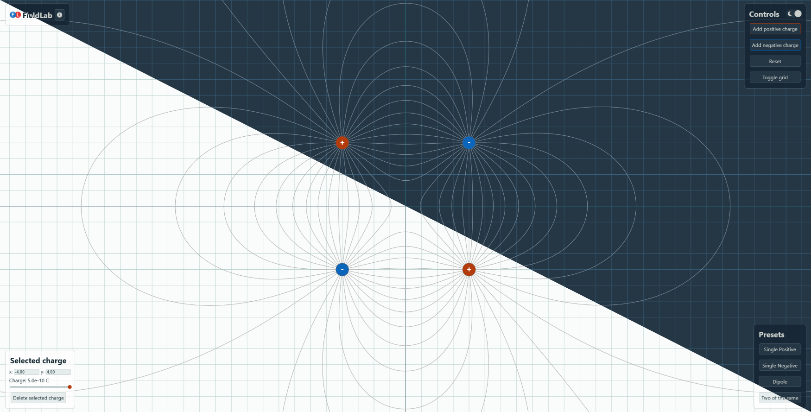

<p align="center"></p>

<h1 align="center">FieldLab</h1>

<p align="center">
  
  
  
  
</p>

## Description
FieldLab is a small interactive simulator for exploring electrostatic fields on a 2D plane. Place positive and negative charges, experiment with their positions and magnitudes, and watch how the resulting field lines take shape.

## Try it out!

<a href="https://geoguy404.github.io/FieldLab/">
  → Try the Live Demo
</a>

## Features

- Create charges and visualize the field lines
- Simulate the interaction of more than one charge
- Move the charges around and see how the field lines change
- Change the magnitude of each individual charge
- Select one of the presets


## Physics

### Electric Field of a Point Charge
$$
\vec{E}(\vec{r}) =
k \cdot Q \cdot
\frac{\vec{r}-\vec{r}_Q}
{|\vec{r}-\vec{r}_Q|^3}
$$

### Field Components

$$
E_x = k \cdot Q \cdot \frac{x-x_Q}{r^3}
$$

$$
E_y = k \cdot Q \cdot \frac{y-y_Q}{r^3}
$$

### Superposition Principle

$$
\vec{E}_{\mathrm{total}} =
\sum_{i=1}^{n} \vec{E}_i
$$


## Limitations
- **Field line generation:** Field lines are currently traced only from
  positive charges. A negative charge still produces an electric field,
  but no field lines are generated from it directly.

- **Calculation limits:** Tracing field lines requires repeatedly
  calculating the total electric field. To limit computational cost,
  each field line is currently restricted to a maximum of 3,000
  calculation steps. Therefore, some lines may terminate before
  reaching their expected endpoint.

## Motivation
I wanted to create a small interactive simulation to refresh my web development and design skills. Since electrostatics had recently been covered in my physics class, this was a good opportunity to test my understanding and implement what I had learned in FieldLab. I also developed FieldLab as my project for Hack Club's Cubed program.

## Running locally

```bash
git clone https://github.com/geoguy404/FieldLab
cd FieldLab
python3 -m http.server 5500
```
Then open:
`http://localhost:5500`

## Build with

- HTML
- CSS
- JavaScript
- HTML Canvas API
- [KaTeX](https://katex.org/)


## License & Credits

Released under the MIT License.

- [License](./LICENSE.md)
- [Credits & Sources](./CREDITS.md)